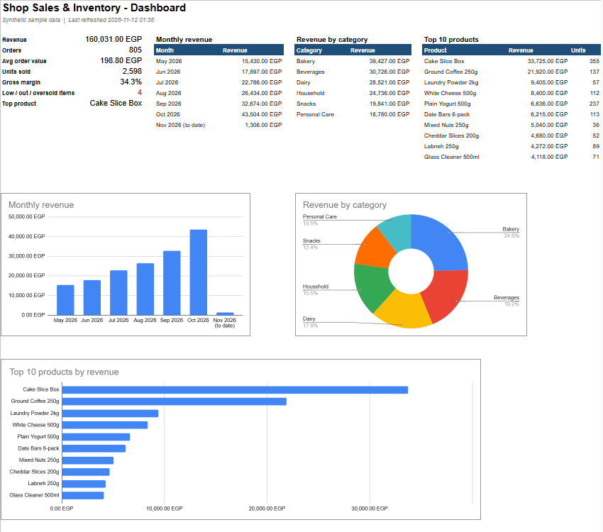
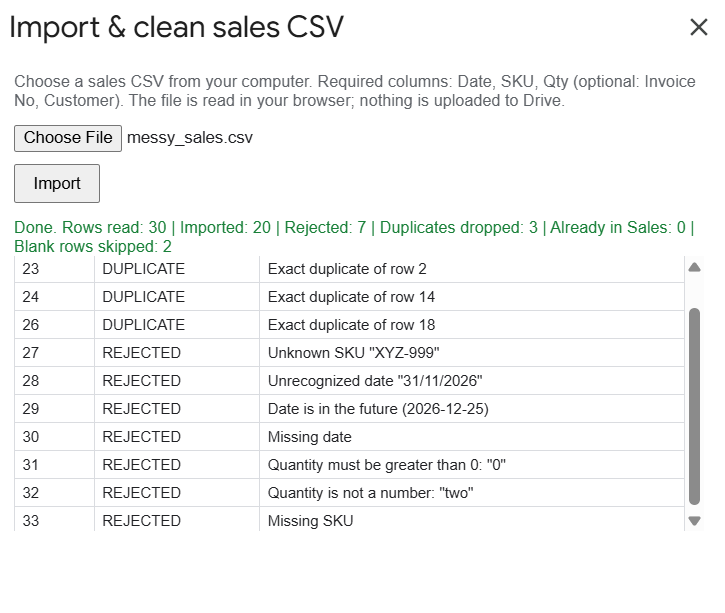
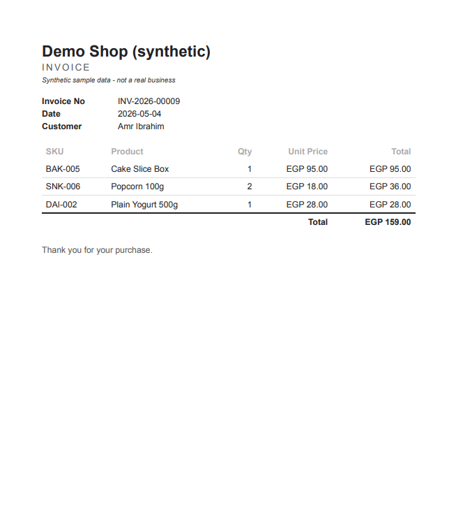
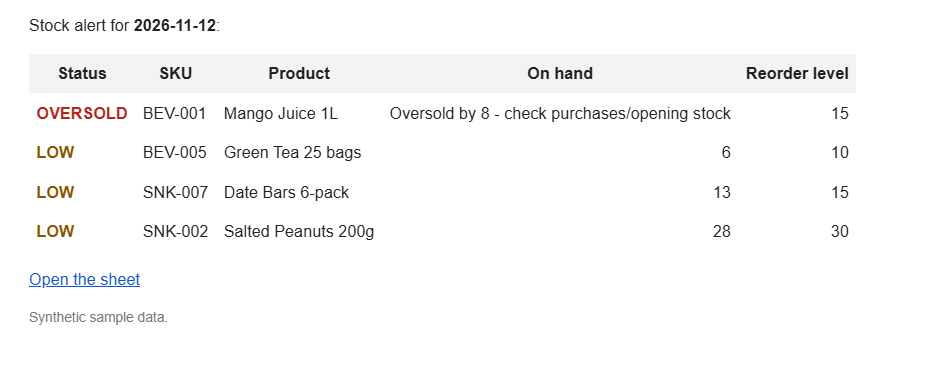
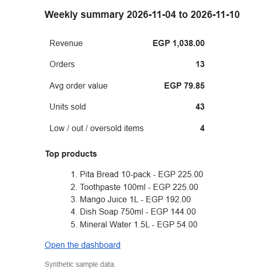

# Shop Sales & Inventory (Google Sheets + Apps Script)

> **Synthetic sample data.** Every product, customer, sale and invoice in this project is generated
> by code for demonstration. No real business or person is represented.

A complete sales and stock system for a small shop, built on Google Sheets and Apps Script.
The whole workbook (sheets, formulas, validation, protection, charts, and sample data) is created
from code, versioned in Git, and deployed with [clasp](https://github.com/google/clasp).
It runs with **5 narrow OAuth scopes**: no full Drive access, no Gmail inbox access, no external requests.



## What it does

| Sheet | Purpose |
|---|---|
| **Dashboard** | Revenue, orders, average order value, units sold, gross margin, low / out / oversold count, top product. Tables and charts: monthly revenue (the unfinished month is labelled "Nov 2026 (to date)"), revenue by category, top 10 products. |
| **Sales** | Date, invoice no, SKU (dropdown), product (auto), qty, unit price (auto), total (auto), customer, source. |
| **Products** | SKU, name, category, unit cost, price, reorder level. |
| **Inventory** | Opening stock + purchases - sold = on hand. Status (color-coded): **OVERSOLD** (< 0, a data problem: check purchases / opening stock), **OUT** (= 0), **LOW** (at or below reorder level), **OK**. |
| **Import** | Paste raw rows here to clean and import them. |
| **Import_Log** | Every import: a summary plus each rejected or duplicate row with its reason. |
| **Settings** | Shop name, owner email, alert hour, currency, weekly summary day. |

### Shop Tools menu

- **Import & clean CSV file...** picks a CSV on your computer. The file is read **in the browser** and only its
  text is sent to the script, so no Drive access is needed. **Import from "Import" sheet** does the same for pasted rows.
  The cleaning step:
  - trims spaces, unifies case, normalizes SKUs and invoice numbers
  - parses mixed date formats (`2026-05-03`, `03/05/2026`, `3 May 2026`, `May 3, 2026`, sheet serials) and
    converts Arabic-Indic digits
  - drops exact duplicates inside the file and skips rows already in Sales (`ALREADY_IMPORTED`), so re-importing is safe
  - rejects invalid rows (missing/unknown SKU, unrecognized or future date, bad quantity, ...) into Import_Log with the reason
  - shows a summary dialog: imported / duplicates / rejected / blank
- **Generate invoice PDF for selected sale** builds a one-page A4 invoice from HTML and saves it to a Drive folder
  the script created itself. Invoice numbers look like `INV-2026-00009`, and the sequence restarts each year.
- **Refresh dashboard**
- **Automation**: install/remove the time triggers, or send either email now.
  - **Daily stock alert** (only sent when something is LOW, OUT or OVERSOLD). Oversold items read
    "Oversold by 8 - check purchases/opening stock" instead of a negative on-hand number.
  - **Weekly summary** with KPIs, top products and a link to the sheet.
  - Installing twice still leaves exactly 2 triggers (existing ones are replaced). Both run in Africa/Cairo time.
- **Rebuild workbook (deletes all data)...** recreates every sheet with fresh sample data after a confirmation,
  and removes any leftover sheet from older versions.

## Screenshots

| | |
|---|---|
|  |  |
| Import of `samples/messy_sales.csv` | One-page invoice PDF |
|  |  |
| Daily stock alert email | Weekly summary email |

## How it was tested

**Unit tests (Node, 74 tests).** All business rules live in pure functions in `src/lib`: cleaning, dates, CSV
parsing, stock status, KPIs, invoice numbers, invoice HTML, and email text. They are tested with `node:test`. A
guard test fails if any `src/lib` file uses an Apps Script service, so the core stays testable outside Google.

**Real Google Sheet (end to end), on a personal Google account:**

| Check | Result |
|---|---|
| Import `samples/messy_sales.csv` (30 data rows) | 20 imported, 3 duplicates, 7 rejected (each with a reason in Import_Log), 2 blank lines skipped |
| Re-import the same file | 0 imported, 20 `ALREADY_IMPORTED`: no double counting |
| Invoice PDF | 1 page, correct total (`INV-2026-00009` = EGP 159.00), saved with `drive.file` only |
| Dashboard | KPIs match the values computed by the Node functions on the same data |
| Emails | Stock alert and weekly summary both received |
| Triggers | "Install triggers" run twice gives exactly 2 triggers: daily 08:00 and Sunday 08:00, Africa/Cairo |

Bugs found in the real sheet and fixed (see git history):
- `DriveApp` always demands the full `drive` scope, so it was replaced with the Advanced Drive Service v3.
- Exporting one sheet with `Spreadsheet.getAs()` still exported all sheets (a 30-page PDF), so the invoice is now
  built as HTML instead.
- A negative on-hand value appeared as "-8", which led to the separate OVERSOLD status.

## Security and privacy

### Only 5 narrow OAuth scopes

| Scope | Why |
|---|---|
| `spreadsheets.currentonly` | Read/write only the spreadsheet this script is bound to, not your other sheets. |
| `script.container.ui` | Menu, dialogs, alerts. |
| `script.scriptapp` | Install/remove the time triggers. |
| `script.send_mail` | Send the alert and summary emails (sending only, no inbox access). |
| `drive.file` | Create the invoice folder and PDFs. Access is limited to files this script created. |

How it avoids full Drive access:
- **CSV import** reads the file in the browser (HTML dialog + `FileReader`), so no Drive scope is needed at all.
- **Drive writes** use the **Advanced Drive Service v3** (`Drive.Files.create`) instead of `DriveApp`. `DriveApp`
  always requires the full `drive` scope, while the Drive API honors `drive.file`. The folder id is stored in
  document properties and the folder is recreated if it is deleted or trashed.
- **Invoice PDF** is built from HTML (`buildInvoiceHtml`) and converted with `Utilities`, with no sheet export and no
  `UrlFetchApp` / `script.external_request`.

Scopes are declared explicitly in `src/appsscript.json`, so Apps Script cannot silently add broader ones.

### Formula-injection guard

Any imported or user-supplied text that starts with `=`, `+`, `-` or `@` (customer names, invoice numbers, sources,
Import_Log reasons and raw rows) is written with a leading apostrophe, so the sheet stores it as text and never
runs it as a formula. HTML output (invoice, emails, dialogs) escapes every value with `escapeHtml`.

### Secrets

`.clasp.json` (script ID) and `.clasprc.json` (clasp login) are git-ignored, and `npm run scan` runs a secret scan
before commits.

## How it is built

```
src/
  appsscript.json     V8, Africa/Cairo, Advanced Drive v3, explicit minimal OAuth scopes
  lib/                PURE business logic - no Google services; tested in Node
    Clean.js Csv.js Dates.js Util.js Inventory.js Kpi.js Invoice.js Settings.js Emails.js Seed.js Config.js
  services/           thin Apps Script wrappers (read/write sheets, Drive, Mail, triggers)
    Setup.js SheetIO.js Import.js Invoice.js Dashboard.js Alerts.js Triggers.js Menu.js
  ui/ImportDialog.html
tests/                node:test suites; src/lib is loaded into a vm context (Apps Script has no modules)
samples/messy_sales.csv   deliberately messy CSV for the import demo
scripts/secret-scan.sh    run before every commit
docs/img/             screenshots
```

- **Pure core, thin shell.** `src/services` only moves data between the sheets and the `src/lib` functions.
- **Deterministic seed.** `setupWorkbook()` always generates the same 40 products and 1,500 sales lines over
  6 months, with a few products deliberately LOW/OUT so the alerts have something to show.
- **Prices are frozen at sale time.** The unit price is copied into the sale row (not a live lookup), so changing
  a product price does not rewrite past sales.
- **Formulas match the code.** The Inventory sheet formulas use the same rules as `computeOnHand()` /
  `inventoryStatus()`. Generated columns are protected.

## Run the tests

Requires Node.js 20+.

```bash
npm test          # TZ=Africa/Cairo node --test "tests/**/*.test.js"
npm run scan      # secret scan (gitleaks if installed, grep fallback)
```

## Deploy with clasp

```bash
npm install -g @google/clasp
clasp login                                   # a personal Google account
clasp create --type sheets --title "Shop Sales & Inventory (synthetic sample data)" --rootDir src
git checkout -- src/appsscript.json           # clasp create overwrites the manifest with a default one
clasp push --force                            # --force: our manifest is the source of truth
```

Then:

1. Open the script editor (`clasp open-script`).
2. Run **`setupWorkbook`** once and approve the permissions. Google shows "Google hasn't verified this app" for
   personal scripts: choose **Advanced**, then **Go to ... (unsafe)**. The consent list should show only the 5
   scopes above.
3. Reload the spreadsheet to see the **Shop Tools** menu.
4. Put a real **Owner email** in Settings, then use **Shop Tools > Automation > Install triggers**.

`.clasp.json` holds only your script ID and `rootDir` and is git-ignored; see `.clasp.json.example`.

## License

MIT
